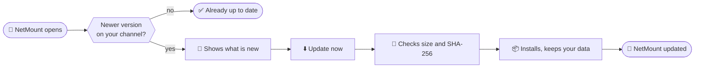

 

### Mount WebDAV, SFTP, SMB and FTP as **real folders**: `/sdcard/Server`

Every app sees it as local storage: file managers, emulators, game launchers, media players. 
Built on **rclone** and **FUSE**. Nothing to install besides the app. No Termux, no Magisk module.

 

[**⬇️ Download Stable**](https://github.com/nomanshabbir-NoOneDev/NetMount-updates/releases/latest) &nbsp;·&nbsp;
[**🧪 Get the Beta**](https://github.com/nomanshabbir-NoOneDev/NetMount-updates/releases/tag/beta) &nbsp;·&nbsp;
[**🚀 First steps**](#-first-steps) &nbsp;·&nbsp;
[**🔄 Updating**](#-updating) &nbsp;·&nbsp;
[**🔑 Guides**](guides/README.md) &nbsp;·&nbsp;
[**🛠️ Troubleshooting**](#%EF%B8%8F-troubleshooting)

 

> [!NOTE]
> This repository holds the **downloads**, the files the app reads to update itself, and the [**guides**](guides/README.md). Install the APK once, and NetMount keeps itself up to date from **Settings → Updates**.

## ✅ What you need

| | |
|---|---|
| 📱 **Phone** | **arm64** with **Android 8.0 or newer** |
| 🔓 **Root** | **Magisk**, **KernelSU** or **APatch**. NetMount asks your root manager for permission on first start |
| 🧩 **Kernel** | **FUSE** support. In a terminal app, `grep fuse /proc/filesystems` should print `fuse` |
| 🖥️ **Server** | **WebDAV**, **SFTP**, **SMB** (Windows or Samba share) or **FTP/FTPS** |

## ✨ Features

<table>
<tr>
<td width="50%" valign="top">

### 🗂️ Storage types
- **WebDAV**
- **SFTP**: password, key file or pasted key, host-key pinning
- **SMB**: guest or login, any share and subfolder
- **FTP/FTPS** *(beta)*
- Several storages at once, each with its own folder, cache and options

### 🎮 Made for games and emulators
- **Games** preset: fetches only the pieces a game asks for
- **Big copies** preset: read-ahead for the fastest transfers
- A cache that remembers what you read (30 days), so the second launch of a big game is far faster than the first

</td>
<td width="50%" valign="top">

### 📈 Monitor and tests
- Live speed, latency and connection quality on the back of every storage card
- **Test connection** with plain-language errors: wrong password, wrong share, certificate, server unreachable
- **Benchmark**: sequential and random reads and writes, with a graph and a copyable report

### 💾 Backup
- Export your storages to a file and import them on another phone
- **Passwords are never exported**

</td>
</tr>
<tr>
<td colspan="2" valign="top">

### 🤖 Automation
| | |
|---|---|
| 🌅 **Mount at boot** | Mounts your storages after the phone starts and the network is up |
| 📶 **Remount on Wi-Fi return** | Brings a stale mount back when Wi-Fi reconnects |
| 🛡️ **Keep mounted** | A small background service restarts a mount that died |
| 🔔 **Alert me when it drops** | A notification when a storage stops or its server cannot be reached, and another when it is back |
| 🏠 **Only on these Wi-Fi networks** | Unmounts when you leave your home network, remounts when you return |
| ⚡ **Quick Settings tile** and **boot script** | One-tap toggle, and a fallback for ROMs that block boot receivers |

</td>
</tr>
</table>

Also: a slim list with search, filters, pins and **Mount all / Unmount all**, dark and light themes, optional Material You colors, and haptics you can turn off.

## 🚀 First steps

1. **Install** the APK and open NetMount. Allow root when your root manager asks.
2. Tap **+**, pick a storage type and enter the name, server address, user and password.
   A server with a self-signed certificate needs **Skip certificate check** *(only on a network you trust)*.
3. Press **Save**, then **Test connection**.
4. Press **Mount** and open `/sdcard/<name>` in any file manager.

> [!TIP]
> Closing the app does **not** unmount your storage. Use **Unmount** for that.

## 🔄 Updating

Open **Settings → Updates**. NetMount checks when it opens (at most every 12 hours, and you can turn that off) and when you press **Check for updates**. If something newer exists, **Update** shows **what is new**, and **Update now** downloads and installs it. Your storages and settings stay, and mounts keep running.

| Channel | You get | Pick it if |
|---|---|---|
| 🟣 **Stable** | Released versions only | You want it to just work |
| 🔵 **Beta** | The newest beta build, **and** the stable release whenever that is newer | You want features early and can live with rough edges |

> [!IMPORTANT]
> Android does not allow installing an older version over a newer one. If you move from Beta back to Stable, you keep the beta build until a newer stable release arrives.

<b>🔐 How updates are kept safe</b>

 

- Each update is checked against its **size** and **SHA-256** before it is installed.
- Android only accepts an update signed with the same key as the installed app, so a swapped file cannot replace NetMount.
- The app contacts **only this repository**, and only to check and download. No analytics, no ads, no telemetry.
- To check a download yourself, compare `sha256sum NetMount.apk` with the `sha256` in `version.json` of the same release.

<b>🧾 Permissions and privacy</b>

 

NetMount needs the `INTERNET` permission **only** for the update check and download. Mounting runs through root and rclone.

| Permission | Why |
|---|---|
| `INTERNET` | Update check and download |
| `ACCESS_NETWORK_STATE` | Wait for Wi-Fi before mounting |
| `RECEIVE_BOOT_COMPLETED` | Mount at boot |
| `POST_NOTIFICATIONS` | Mount problems and drop alerts |
| `FOREGROUND_SERVICE` | The short boot service and the watchdog (Android 14+ also needs its special-use type) |

Passwords are stored encrypted with a key held by the Android Keystore, and never appear in logs or notifications.

## 🔑 Guides

Google Drive, Dropbox and OneDrive can use **your own app keys**, which ends the shared "rate limit" errors. Step-by-step guides, every click included:

- [Google Drive keys](guides/google-drive.md)
- [Dropbox keys](guides/dropbox.md)
- [Microsoft OneDrive keys](guides/onedrive.md)

## ⚠️ Good to know

- 🧪 Tested by hand on **one phone** (OnePlus, Android 16, KernelSU). **Magisk** and **APatch** are expected to work but are not verified yet, and neither are older Android versions.
- 🔒 NetMount connects by **IP address**, so a certificate issued for a hostname does not match: use **Skip certificate check** on a trusted network.
- 🐢 SMB through rclone is not faster than WebDAV. For games prefer **WebDAV**, and avoid SFTP for anything that reads at random.
- 🎯 **Anti-cheat:** online games with anti-cheat can react to a rooted phone or a visible FUSE mount. Use mounted storage with games at your own risk.

## 🛠️ Troubleshooting

<b>Update problems</b>

 

| Message | What to do |
|---|---|
| "Already up to date" but you expect an update | Check that the channel under **Settings → Updates** is the one you want |
| No internet connection / could not reach the update server | The phone cannot reach `github.com` |
| The downloaded file does not match its checksum | The download was damaged and deleted. Try again |
| `INSTALL_FAILED_UPDATE_INCOMPATIBLE` | The installed app was signed with a different key. Export your storages, uninstall it, then install this APK |
| `INSTALL_FAILED_VERSION_DOWNGRADE` | You already have a newer build than the one offered |

<b>Mount problems</b>

 

| Message | What to do |
|---|---|
| `errno 1` | SELinux refused the mount. Turn on **Set SELinux permissive if mount is denied** in the storage's Advanced options |
| `errno 19` | Your kernel has no FUSE |
| Folder empty in other apps | NetMount retries on its own with another path; the log says which one it used |
| `x509: certificate signed by unknown authority` | Self-signed certificate. Turn on **Skip certificate check** (trusted network only) |
| 401 / "rejected the username or password" | Wrong credentials |
| Connection refused / timeout | Check the address, the port, and that you are on the right network |

**Settings → Logs** shows what NetMount did and why, with a Share button. Passwords are never in it.

## 📦 About this repository

Everything here is published automatically by the build system.

| File | What it is |
|---|---|
| `NetMount.apk` | The app, in each release |
| `version.json` | Version, SHA-256, size, a short note and the changelog the app shows before updating |
| release **`beta`** | Replaced by every beta build |
| releases **`v…`** | Stable releases, each one kept |

Please do not edit releases by hand: the app only installs a file whose size and SHA-256 match `version.json`.

NetMount · rclone + FUSE · made for rooted Android

